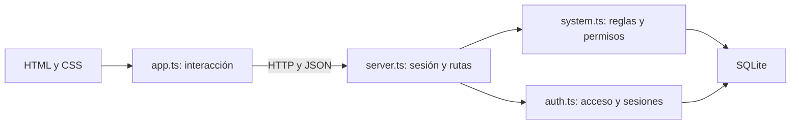

# Arquitectura del SG-CICT

## Objetivo

Mostrar una implementación pequeña pero funcional de los recorridos de la P2. Se utiliza una sola aplicación local para que puedas seguir las reglas sin configurar varios servidores.



## Mapa de carpetas

```text
prototipo/
├── public/                Pantallas y recursos del navegador
│   ├── index.html         Documento de entrada
│   ├── styles.css         Sistema visual y adaptación a móvil
│   ├── app.ts             Estado de interfaz, peticiones, diálogos y eventos
│   ├── views.ts           Construcción del HTML de cada pantalla
│   ├── ui.ts              Iconos, formatos y escape de datos
│   └── favicon.svg        Identidad visual local
├── src/
│   ├── server.ts          Arranque, HTTP, recursos públicos y exportación
│   ├── system.ts          Operaciones completas del sistema
│   ├── auth.ts            Contraseñas, acceso y sesiones
│   ├── time.ts            Fechas de Madrid e intervalos
│   ├── database.ts        Conexión y transacciones
│   ├── schema.sql         Tablas, restricciones e índices
│   ├── seed.ts            Datos ficticios iniciales
│   └── model.ts           Tipos compartidos y errores de dominio
├── tests/                 Pruebas del sistema y de HTTP
├── scripts/               Comprobación, reinicio y revisión del navegador
├── docs/                  Documentación
└── data/                  Base local generada, excluida de Git
```

## Por qué estas divisiones

`CictSystem` expone operaciones como `createBooking`, `cancelBooking` y `resolveIncident`. Sus llamadores no necesitan reproducir los pasos internos de validación, asignación, persistencia y avisos. Es el módulo donde se concentran esas reglas.

El constructor recibe la base y una función `now`. Las pruebas pueden usar una base en memoria y un reloj fijo, mientras que el servidor usa la hora real. No hace falta simular clics para comprobar una regla de prioridad.

`server.ts` interpreta HTTP y devuelve JSON o archivos públicos. `app.ts` interpreta interacciones del navegador. `views.ts` genera el HTML y `ui.ts` escapa los datos. No se introduce un módulo independiente por cada consulta SQL trivial.

## Un recorrido completo: reservar

1. `bookingDialog` muestra el formulario con fecha y horas de Madrid.
2. `bookingInput` transforma sus campos en un `BookingInput`.
3. `request` envía JSON a `POST /api/bookings`, con cookie de sesión y token CSRF.
4. La ruta obtiene la persona autenticada de `Auth.session`; no acepta una identidad elegida por el navegador.
5. `createBooking` abre `BEGIN IMMEDIATE` y ejecuta `plan`.
6. `plan` verifica permisos, contrato, horario, estado del instrumento, citas incompatibles, prioridad y disponibilidad de técnicos.
7. Si procede, marca reservas externas como desplazadas y registra sus avisos.
8. Inserta la nueva reserva, su confirmación y la actividad.
9. Se confirma la transacción. Cualquier excepción revierte todos los cambios.
10. El navegador vuelve a obtener el estado y representa el resultado.

Comprobar disponibilidad es informativo. Confirmar siempre vuelve a validar: otro usuario puede haber reservado entre ambos pasos.

## Modelo de datos

| Tabla | Responsabilidad |
| --- | --- |
| `users` | Persona, perfil, entidad, contrato y resumen de contraseña |
| `instruments` | Equipo, sala, técnica, necesidad de supervisión y averías |
| `bookings` | Intervalo previsto, técnico, tipo, estado, uso real y cancelación |
| `incidents` | Avería, apertura, resolución y fecha de reparación |
| `notifications` | Bandeja que representa las notificaciones por correo |
| `sessions` | Resumen del token, persona, CSRF y caducidad |
| `activity` | Eventos del recorrido para el panel de actividad |

La sala se almacena como texto del instrumento: no se reserva ni se convierte en recurso exclusivo. Contrato y cliente se representan con campos de la cuenta, suficientes para este ejemplo. En un sistema con varios contratos y facturación jurídica se separarían esas entidades.

## Estados

Una reserva pasa de `confirmada` a `cancelada`, `desplazada` o `en_uso`; de `en_uso` pasa a `finalizada`. Cancelación y desplazamiento liberan el intervalo. No hay una ruta para cambiar arbitrariamente de estado.

El equipo tiene estado persistente `disponible` o `averiado`. El mantenimiento es una reserva temporal. Su presentación «En mantenimiento» se calcula para el momento actual; programar trabajo futuro no bloquea todos los días del calendario.

## Concurrencia y persistencia

Las operaciones de negocio son síncronas dentro de una transacción. SQLite permite un escritor; `BEGIN IMMEDIATE` adquiere esa posición antes de comprobar e insertar. La misma operación no puede aceptar dos reservas incompatibles mediante una carrera entre dos peticiones. La base utiliza claves externas, restricciones, índices, modo WAL y espera limitada de bloqueo.

Es un diseño local y de volumen pequeño. `DatabaseSync` y `scryptSync` bloquean el proceso mientras trabajan. Una aplicación desplegada para muchos usuarios necesitaría revisar la concurrencia, el coste de autenticación y la organización de la persistencia.

## Navegador y TypeScript

Node elimina las anotaciones de tipos de `public/*.ts` y entrega módulos JavaScript. Los `import type` del modelo desaparecen. El navegador nunca ejecuta TypeScript directamente ni recibe el código del servidor.

No se emplean React, Vite, npm ni bibliotecas de terceros para arrancar. Es una decisión didáctica para poder leer el flujo completo y utilizar los módulos ya disponibles en el entorno. La eliminación de tipos no comprueba su corrección estática.

## Controles incluidos

Contraseñas con scrypt y sal aleatoria; cookies `HttpOnly` y `SameSite=Strict`; sesiones con caducidad; validación del origen y token CSRF en cambios; consultas preparadas; límites de campos/cuerpo; escape de contenido; política CSP; recursos públicos en lista cerrada; anonimización de reservas ajenas para perfiles de investigación/consulta.

Estos controles no equivalen a certificar seguridad de producción ni cumplimiento normativo. El prototipo utiliza HTTP en loopback y cuentas públicas ficticias.
